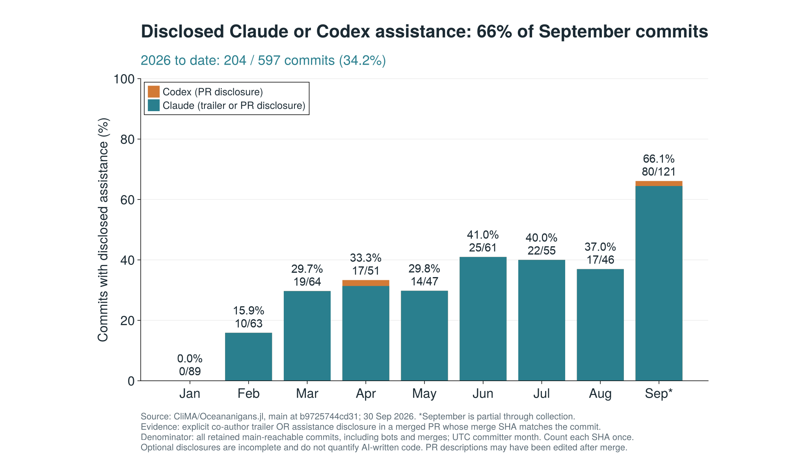

# Ocean modeling at the dawn of AI

**Risks and opportunities for usage, development, and parameterization**

Gregory Wagner · NEMO 2026 Developers’ Workshop · 13 October 2026

Working presentation and supporting analysis. The presentation snapshots were exported on **6 October 2026** and include preliminary appendix material.

## Presentation

- [PDF](presentation/nemo-ai-keynote.pdf)
- [PowerPoint](presentation/nemo-ai-keynote.pptx)
- [Text outline and source links](presentation/outline.md)
- [Working Google Slides deck](https://docs.google.com/presentation/d/1BCanQCPBgMl--LgAgLu-PaBM4s2KVMblNFeLsFNUoB4/edit?usp=sharing)

The talk considers AI in model **usage**, **development**, and **parameterization**, including opportunities for faster experimentation and risks to attribution, understanding, human control, and equitable access.

## NEMO WENO case study

[glwagner/nemo-weno](https://github.com/glwagner/nemo-weno) contains the implementation and write-up for the talk’s case study on AI-assisted development of WENO advection in NEMO.

## Oceananigans development analysis

[Methods, findings, and limitations](analysis/README.md) document an observational analysis of the public [CliMA/Oceananigans.jl](https://github.com/CliMA/Oceananigans.jl) repository, captured on **30 September 2026**: 3,731 PRs and 13,845 commits reachable from main at `b9725744cd313ed368bb7906880a5d884c4c78bf`.

The code measures PR activity, participating accounts, approximate open-PR inventory, and explicit Claude/Codex assistance disclosures. **These measures do not establish a causal effect of AI on productivity.** Missing disclosure does not mean no AI use, and commit credit does not measure the fraction of AI-written code.



All seven figures are provided as PNG and vector PDF in [`analysis/`](analysis/). Python scripts parse and tabulate data; **all plotting uses Julia/CairoMakie**.

## Reproduce the figures

The [NEMO analysis](nemo-analysis/README.md) applies the same approach to 1,214 public merge requests and 2,258 distinct commits across NEMO's main and release branches, captured on 6 October 2026. No searched AI-tool markers were found. Discussion APIs require authentication, and no comments were assessed; zero public disclosure does not establish zero AI use. Three additional Julia-generated figures show NEMO activity and the disclosure comparison.

Requires Python 3 (standard library only), Julia 1.12, and GNU Make or an equivalent make. The Julia environment is pinned in `analysis/Project.toml` and `analysis/Manifest.toml`. Plots request Arial; font substitution may change layout on systems without it.

```sh
make setup       # Install the pinned Julia dependencies
make reproduce   # Check input hashes, rebuild tables, render all seven figures
make nemo        # Rebuild the NEMO analysis and its three figures
```

The frozen inputs are included, so rebuilding does not require GitHub authentication or a fresh data download. `analysis/data/SHA256SUMS` records their checksums. To run without Make, see [`analysis/README.md`](analysis/README.md).

`analysis/fetch_prs.py` collects a **new** public PR snapshot into a separate output directory. Its results will differ from the frozen snapshot; the analysis windows and manually reviewed disclosure exclusions are specific to September 2026 and must be revisited for a refresh.

## Data provenance and attribution

Inputs contain public GitHub PR text and public Git commit metadata, including contributor names and email addresses already present in that repository’s Git history. Unused GitHub API fields and duplicate pagination responses are omitted. Source URLs, hashes, exact attribution trailers, and disclosure excerpts are retained so the analysis can be audited.

Third-party paper/title screenshots and news clippings in the presentation remain attributed to their original authors and publishers. Their inclusion illustrates the talk’s discussion; it does not imply endorsement. Source links are embedded in the deck and collected in the outline. Public availability of this repository does not change the rights in third-party materials.

The initial analysis and presentation preparation were assisted by OpenAI Codex. Interpretations and presentation content remain a working draft for author review.
