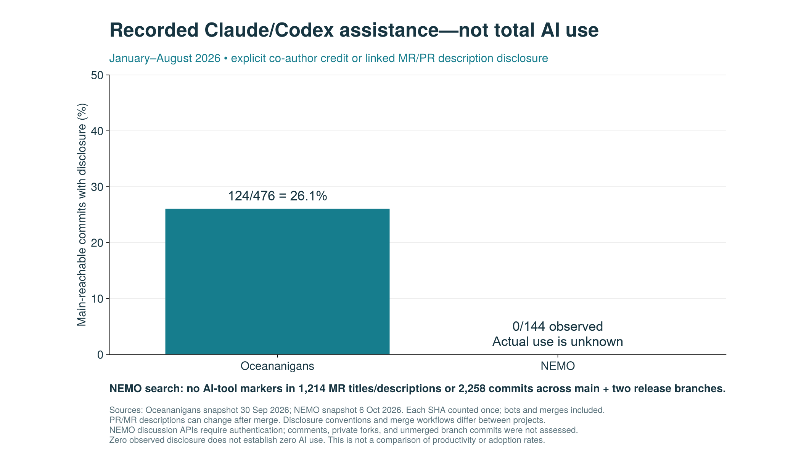

# NEMO development and public AI disclosures

Analysis of the **NEMO ocean model**, not NVIDIA NeMo or the Nemo desktop application. Data collected anonymously on **6 October 2026** from the official public project, [forge.nemo-ocean.eu/nemo/nemo](https://forge.nemo-ocean.eu/nemo/nemo). The [official installation guide](https://sites.nemo-ocean.io/draft-guide/install.html#download-and-install-the-nemo-code) identifies this repository and its main/release branches.

## Main finding

**No explicit Claude/Codex attribution or other searched AI-tool wording was found in the accessible material. This does not establish that NEMO developers are not using AI.**

| Public record examined | Coverage | Matches |
|---|---:|---:|
| MR titles and descriptions, all states/target branches | 1,214 | 0 |
| Commit messages reachable from `main` | 1,555 | 0 |
| Distinct commits across `main`, `branch_5.0`, `branch_4.2` | 2,258 | 0 |
| Claude or Codex co-author trailers across those branches | 2,258 commits | 0 |

The union of branch histories is deduplicated by SHA; the 1,555 main commits are included in the 2,258, not additional. No primary Git author identity matched the search vocabulary. There were no keyword candidates requiring manual classification.

The search covered `Claude`, `Codex`, `Anthropic`, `OpenAI`, `Copilot`, `ChatGPT`, `LLM/LLMs`, `AI-assisted/generated` variants, standalone `AI`, `GPT`, `Gemini`, `language model`, and `artificial intelligence` (case-insensitive; patterns are in `analyze.py`). Absence of these strings does not rule out assistance described in other words or languages.

### Access limit

Public Git cloning and project/MR listing APIs worked without credentials. The project notes-search API and the MR-notes API returned **HTTP 401**. **No discussion comments were searched.** `data/access-checks.json` records the observed endpoints and responses. This analysis also excludes confidential/deleted MRs, private forks, unmerged topic-branch commits, local work, issues, and prior SVN/Trac records. It is an audit of public disclosure in a defined sample, not an AI-use detector.

## Activity in matched periods

January–August in each year, all target branches; accounts whose usernames match a bot pattern are excluded (none were found).

| Metric | 2024 | 2025 | 2026 | 2025–2026 change |
|---|---:|---:|---:|---:|
| MRs opened | 237 | 172 | 155 | −9.9% |
| MRs merged during period | 224 | 149 | 125 | −16.1% |
| Distinct MR-opening accounts | 20 | 17 | 20 | +17.6% |
| First observed MR-opening accounts | 5 | 3 | 5 | +2 accounts |
| MRs opened targeting main | 187 | 89 | 94 | +5.6% |
| MRs merged targeting main | 183 | 75 | 70 | −6.7% |

This shows no surge in all-target MR volume in 2025–2026, but **cannot establish the presence, absence, or effect of AI adoption**. Main-target submissions increased slightly. Release/backport practices affect totals: 803 of all 1,214 MRs target main, 202 target `branch_5.0`, 177 target `branch_4.2`, and 32 target other branches. The same work may generate several MRs. A count of accounts is not a count of distinct people, reviewers, or everyone developing NEMO.

The snapshot has 1,008 merged MRs, 135 closed without merge, and 71 open. Historical open inventory in the CSV is approximate: it uses creation and final merge/closure timestamps and cannot reconstruct reopenings. Inventory does not measure reviewer workload or delay.

## Comparing the disclosure record with Oceananigans

For **January–August 2026**:

- Oceananigans: **124 / 476 main-reachable commits (26.05%)** carry explicit Claude/Codex co-author credit or link to a reviewed assistance disclosure in a merged PR.
- NEMO: **0 / 144 main-reachable commits (0% observed)** carry such credit; no MR description anywhere in the NEMO snapshot mentions either provider, so the description-based extension adds nothing.

Both denominators include retained merge and bot commits and use UTC committer dates; each SHA counts once. Oceananigans was captured 30 September, NEMO 6 October. Current PR/MR descriptions can have changed after the associated commit or opening date. The two projects differ in merge workflows, disclosure conventions, and project organization. **These percentages must not be presented as comparative AI adoption rates or productivity.**



## Figures

1. [`01-nemo-development-timeline.png`](01-nemo-development-timeline.png): monthly MR submissions, merges, active accounts, and first observed accounts through September 2026. Thin lines show monthly counts; thick lines show trailing three-month means.
2. [`02-nemo-matched-periods.png`](02-nemo-matched-periods.png): January–August activity comparisons.
3. [`03-nemo-ai-disclosure.png`](03-nemo-ai-disclosure.png): observed Claude/Codex commit disclosures for NEMO and Oceananigans in the same January–August period.

Each figure also has a vector PDF. All plots use Julia/CairoMakie with the environment pinned in `../analysis/`.

## Snapshot and methodology

- GitLab project ID: **24**. Downloaded all 13 pages of the public [merge-request listing API](https://forge.nemo-ocean.eu/api/v4/projects/24/merge_requests?scope=all&state=all&per_page=100), sorted by creation time. The first page reported 1,214 records; 1,214 unique MRs were retrieved. MR IDs contain gaps; gaps do not establish missing accessible records.
- Collection ran from `2026-10-06T23:17:34Z` to `2026-10-06T23:17:50Z`. Pagination and Git cloning are not atomic snapshots.
- Main: `92d51bdffa24de9e7c14e0624759cb4bfc13d35f` (1,555 reachable commits).
- `branch_5.0`: `501597e3f5739b0a9484cd9f260f7309da8d1376` (1,323 reachable commits).
- `branch_4.2`: `2a3645ca7dd56acd4fea5bd570890f4fbe4739da` (488 reachable commits).
- The public GitLab record begins in **November 2021**, with an initial Git commit on 30 November. It is not the complete history of NEMO development. Figures start in January 2022; first observed contributors can be longstanding NEMO developers whose earlier work predates this record.
- Contributor identity uses GitLab numeric author ID, avoiding double counts from username changes within the retrieved data. Account aliases and multiple accounts are not resolved. Bot detection is a username heuristic, not a verified account-type audit.
- Opened and merged counts use their respective timestamps; UTC is used throughout. October 2026 is partial and excluded from the activity plots. Annual comparisons consistently stop at August for comparability with the Oceananigans figures.
- Title/description matches and co-author trailers are distinct measures. With zero keyword matches in this snapshot, both the strict co-author metric and the broader linked-description metric are zero. No probability bound on actual AI usage is warranted because disclosure is neither mandatory nor randomly sampled.

## Reproduce

From the repository root (no network or credentials required after Julia dependencies are installed):

```sh
make setup
python3 nemo-analysis/analyze.py
julia --startup-file=no --project=analysis nemo-analysis/plot.jl
(cd nemo-analysis/data && shasum -a 256 -c SHA256SUMS)
```

`data/merge_requests.json.gz` retains only the public MR fields needed by the analysis. `data/all-branches-commits.raw.gz` contains public Git metadata and messages; `*-commits.txt` preserve branch membership. `data/commits.raw.gz` is the main-only Git log. The derived CSVs, summary, branch tips, and checksums are committed. Public Git metadata includes already-public contributor identities and email addresses.

`fetch_snapshot.py --output /path/to/new-directory` collects a new MR snapshot. Use a separate output directory: the code refuses to overwrite the frozen MR input. Updating the analysis also requires a matching Git snapshot and revised dates, labels, disclosure review, and documentation. Do not silently substitute current data for this snapshot.

For further evidence of actual use, ask NEMO developers about their tools and disclosure conventions, or—with appropriate access—extend the audit to discussion comments and unmerged branches. Absence of an attribution footer is not evidence of unaided development.
